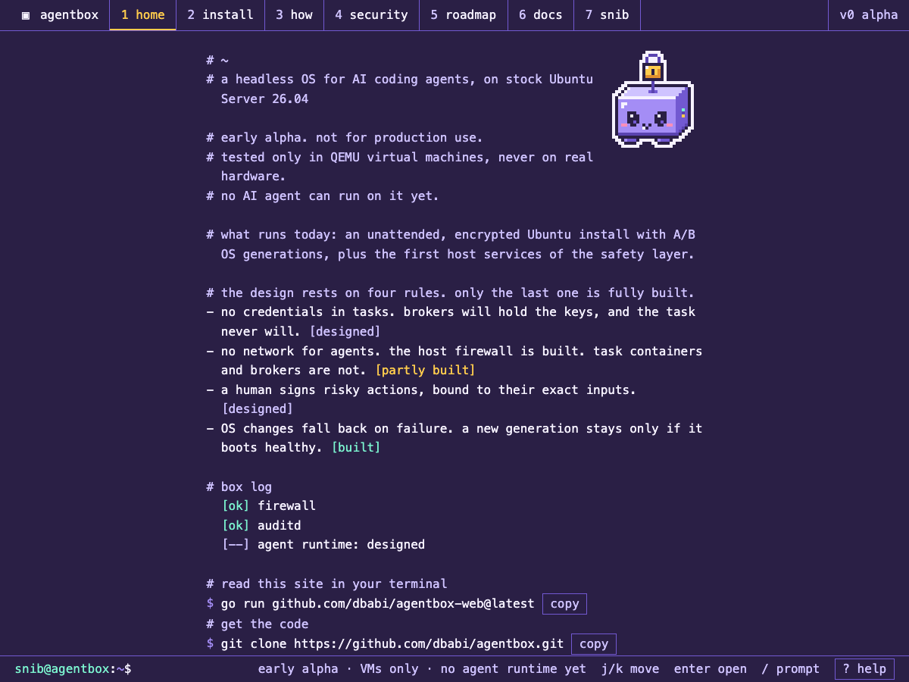

# agentbox-web

The website and terminal app for [agentbox](https://github.com/dbabi/agentbox), a headless OS for AI coding agents.
agentbox is early alpha: it runs only in QEMU VMs, and no agent can run on it yet.

One content source feeds two front ends:

- a terminal-style static site, live at **https://dbabi.github.io/agentbox-web/**
- the same pages as a Bubble Tea TUI, which you run locally



## Run the TUI

```sh
go run github.com/dbabi/agentbox-web@latest
```

You need Go 1.26 or newer. Press `?` for the keys, `1`-`7` for a tab and `q` to quit.

```sh
go run github.com/dbabi/agentbox-web@latest security          # start on a tab
go run github.com/dbabi/agentbox-web@latest -plain security   # plain text, for screen readers and pipes
go run github.com/dbabi/agentbox-web@latest -art guarding     # Snib only; NO_COLOR=1 gives the ASCII map
go run github.com/dbabi/agentbox-web@latest -motion=false     # stop the idle loop on the snib tab
```

Colors are the Snib palette hexes. Bubble Tea downsamples them to 256 or 16 colors when the terminal needs it.
With `NO_COLOR` or a dumb terminal, Snib becomes an ASCII map. The active tab always has brackets and the cursor
line always has a `▌` bar, so no state depends on color.

## Local SSH mode

The TUI can also serve itself over SSH, for a local look. It is not deployed anywhere.

```sh
go run . serve               # listens on 127.0.0.1:23234
ssh -p 23234 -t 127.0.0.1 security
```

It is locked down in code:

- It listens on 127.0.0.1 by default. `-listen` or `AGENTBOX_SITE_LISTEN` can change that, and it logs a warning
  for a non-loopback address.
- The host key is a new in-memory ed25519 key per start. `-host-key <path>` uses a file instead, and is refused
  inside a git work tree. `.gitignore` lists `id_ed25519*`.
- Read-only: sessions get only the TUI, and a PTY is required. The only exec commands are the 7 page names.
  There is no shell, no port forwarding, no subsystem (so no SFTP or SCP) and no agent forwarding. The SSH library
  still answers "yes" to an agent request, but the server never opens an agent channel. A test checks this.
- Caps: 32 open connections, one session per connection, 5 new sessions per IP then 1 per second, a 10 s
  handshake, a 120 s idle cutoff and a 30 min session cap. The window size the client sends is capped at 500x300,
  and prompt input at 64 characters. The TUI shows a sleeping Snib after 110 s with no key and ends the session
  10 s later.
- Session logs hold the start, the end, the duration, the end reason (`refused` for an exec, a missing PTY or a
  second session) and the first 8 hex of a salted SHA-256 of the remote IP. They never hold the command, env,
  keys, terminal type or typed input. The SSH library logs the remote address on a panic; `serve` redacts it.

## Build and preview the site

`cmd/sitegen` renders `content/` to static HTML in `web/`: one page per tab, plus `404.html`, `style.css` and
`keys.js`. There is no framework, no npm, no webfont and no request to another site. Every page works with
JavaScript off. With it on, `keys.js` adds the line cursor (j/k), the prompt (/), copy (enter, c), help (?) and the
snib-page motion toggle (m).

```sh
go run ./cmd/sitegen        # after any change to content/, then commit web/
go test ./...               # fails if web/ is stale, among other checks
go run ./cmd/preview        # serves web/ on http://127.0.0.1:8080/agentbox-web/ only
```

`baseURL` in `cmd/sitegen` is `https://dbabi.github.io/agentbox-web/`. Pages use relative links, `404.html` uses
the base path, and `og:image` uses the full URL. On every push to `main`, `.github/workflows/pages.yml` runs
`sitegen` and deploys `web/` to GitHub Pages.

Dark is the default; a light scheme follows `prefers-color-scheme`. Motion stops under `prefers-reduced-motion`.

## Layout

- `content/NN-slug.md`: one file per tab. Front matter (`key`, `slug`, `title`, `pose`, `sources`), then a line
  subset: `# comment`, `$ command`, `- bullet`, `1. step`, `> CAUTION: text`, `[text](url)` links, `[built]` style
  status tags, ``` blocks and `{{palette}}`. `sources` names the docs in dbabi/agentbox the page condenses. When
  one of them changes, review the page.
- `content/snib/`: the mascot grids. `content/content.go` parses the pages once. It lives next to the files because
  `go:embed` cannot reach outside its directory.
- `internal/snib`: adds the Highlight die-cut ring and renders a pose as 24-bit half blocks, ASCII or inline SVG.
- `internal/tui`: the Bubble Tea app. `internal/serve`: the same app over SSH with Charm Wish.
- `mascot/`: the favicons and social preview image the site uses.

## Dependencies

Dependencies are pinned in `go.mod` and `go.sum`. To change one:

```sh
go get <module>@<version> && go mod tidy
```

On a network that cannot reach proxy.golang.org, prefix both with
`GOPROXY=direct GONOSUMDB=charm.land,github.com/charmbracelet`.

Every dependency is MIT, BSD-3-Clause or Apache-2.0, except `github.com/hashicorp/golang-lru/v2`, which is MPL-2.0
and used unmodified. `rivo/uniseg`, `charmbracelet/ultraviolet` and `golang.org/x/exp` are pseudo-versions because
charm's own `go.mod` pins them so.

CI runs gofmt, vet, tests, staticcheck, govulncheck and the `web/` drift check.

## License

The code is Apache-2.0, see [LICENSE](LICENSE). The Snib art is CC BY 4.0, see [mascot/README.md](mascot/README.md).

agentbox itself, its docs and its security policy live in [dbabi/agentbox](https://github.com/dbabi/agentbox).
